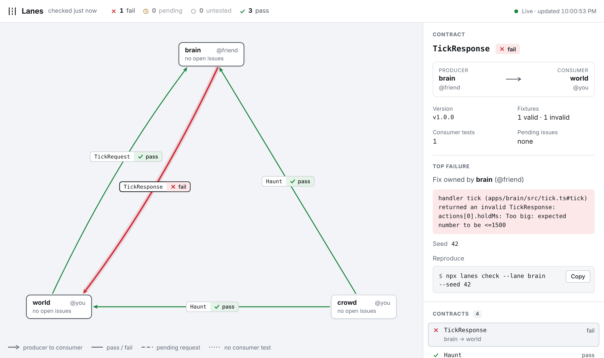

# Lanes

**Contract-first parallel development for coding agents. Small tool, hard guarantees.**

Lanes lets several coding agents (and humans) build one project in parallel without breaking each other:

- **Lanes**: the project is split into lanes, each owning its own folders (`lanes.yaml`).
- **Contracts**: lanes talk only through zod schemas plus JSON fixtures (`contracts/`, `fixtures/`).
- **Checks**: every contract is checked mechanically: fixtures, consumers' tests, schema-generated values,
  mutations of fixtures, and **property tests of handler code that agents can't game** (seeded, shrunk to the
  smallest counterexample).
- **Enforcement**: Claude Code hooks block cross-lane edits and changes to locked contracts *while agents work*.
  A git pre-commit hook and a merge queue back them up for every other tool.
- **Communication and merging**: agents message each other through GitHub Issues. A watcher wakes a fixer
  subagent in an isolated worktree, and a stateless merge queue keeps `main` green.
- **Visibility**: a live graph shows which interface is broken and who owns the fix.

No model calls in the tool: every check is deterministic, so it's free, fast, and agents can't argue past it.
Removing Lanes leaves a normal repo (plain zod, vitest, YAML, GitHub labels).



It ships as **one CLI** (`contract-lanes`, command `lanes`), **a Claude Code plugin** (`plugin/`) and **one
GitHub Action workflow** (`lanes init` writes it). All three call the same code.

## Quickstart (zero to green in under a minute)

In Claude Code:
```
/plugin marketplace add srikondapalli1/contract_lanes_plugin
/plugin install lanes@contract-lanes
/lanes:init
```
Or from a shell, in an empty or existing repo:
```bash
npx --yes github:srikondapalli1/contract_lanes_plugin init     # writes lanes.yaml, an example contract, hooks, workflow
npm install                                                    # contract-lanes + vitest + zod (devDependencies)
npx lanes check                                                # green on the first run
git add -A && git commit -m "lanes init"
npx lanes join app                                             # one lane per session/worktree
npx lanes lock                                                 # when interfaces settle: main becomes queue-only
```
> `contract-lanes` isn't on npm yet, so `init` points the devDependency at this GitHub repo (the package is the repo
> root, and its built `plugin/bin` is committed). Override with `--pkg <spec>` or `LANES_PKG`. Until this work is merged
> to `main`, append `#claude/great-dirac-zmefii` to the `github:` specs and the marketplace (`/plugin marketplace add
> srikondapalli1/contract_lanes_plugin#claude/great-dirac-zmefii`). Verified: `npx github:…#claude/great-dirac-zmefii init`
> → `npm install` → `lanes check` green in 11 s, over the network.

For a GitHub repo, `lanes init --labels` (rerunnable) creates the labels and the pinned "Lanes control" issue.
Then protect `main`: require a PR plus the `lanes/check` status. Don't require code-owner review: the queue
enforces review only for cross-lane and major contract changes.

## How it looks

```yaml
# lanes.yaml
lanes_version: "^0.1.0"
approvers: ["@you"]
lanes:
  world: { owner: "@you",    paths: ["apps/world/**"] }
  brain: { owner: "@friend", paths: ["apps/brain/**"] }
  crowd: { owner: "@you",    paths: ["apps/crowd/**"] }
contracts:
  TickRequest:  { producer: world, consumers: [brain] }
  TickResponse: { producer: brain, consumers: [world] }
  Haunt:        { producer: crowd, consumers: [world, brain] }
handlers:
  tick: { lane: brain, module: "apps/brain/src/tick.ts#tick", input: TickRequest, output: TickResponse }
```

`lanes check` on [`examples/three-lanes`](examples/three-lanes) (brain's handler has a planted bug: spooked agents hold 1800 ms, max 1500):
```
lanes check · local · main · seed 42
✅ pass      TickRequest   world → brain  v1.0.0 · fixtures 2 valid/2 invalid · 2 consumer test(s)
❌ fail      TickResponse  brain → world  v1.0.0 · fixtures 1 valid/1 invalid · 1 consumer test(s)
✅ pass      Haunt         crowd → world  v1.0.0 · fixtures 1 valid/1 invalid · 2 consumer test(s)
✅ pass      Haunt         crowd → brain  v1.0.0 · fixtures 1 valid/1 invalid · 1 consumer test(s)

Failures (1):
  ✗ [handler-property] TickResponse · owner brain: handler tick (apps/brain/src/tick.ts#tick) returned an invalid
    TickResponse: actions[0].holdMs: Too big: expected number to be <=1500
      seed: 42
      counterexample: {"tick":0,"worldId":" ","agents":[{"id":"a-0","at":{"x":0,"y":0},"mood":"spooked"}]}
      repro: npx lanes check --lane brain --seed 42

✅ 3 pass · ❌ 1 fail · ⏳ 0 pending · ○ 0 untested   (1.5s, exit 1)
```

While an agent bound to `brain` works, the guard answers its edits:
```
Blocked: apps/world/src/apply.ts belongs to lane "world"; you are in "brain". Ask instead: npx lanes msg world
--type request "<what you need>". Override (logged): npx lanes override apps/world/src/apply.ts --reason "<why>".
```

## Commands

| Command | Purpose |
|---|---|
| `lanes init [--labels] [--lanes a,b,c] [--laptops n --sessions n --hours n]` | Skeleton, example contract, hooks, workflow, CODEOWNERS, AGENTS.md rules; `--labels` sets up GitHub |
| `lanes join <lane>` | Bind this worktree to a lane (`.lanes/local.json`) and install git hooks |
| `lanes check [--lane l] [--fast] [--ci] [--json] [--seed n\|random] [--file-blockers] [--pr n]` | Config → ownership → schemas → fixtures → generated + mutations → handler properties → consumer tests → lock → edges. Exit 0/1/2 |
| `lanes lock [--allow-open n]` | Write `contracts.lock`; ends setup phase |
| `lanes msg <lane> --type request\|notice\|blocker [--contract C] "<text>"` | Open or update (dedup) a GitHub issue to a lane |
| `lanes watch --lane <l> [--once]` | Zero-token background poller; exits with one JSON line when something actionable arrives |
| `lanes fix <n> [--submit \| --escalate "r" \| --cleanup]` | Claim + lease + isolated worktree; gated submit opens a `queue` PR |
| `lanes queue` | Stateless merge queue (CI): rebase, re-check, review rules, relock, squash-merge, post-merge blockers |
| `lanes graph [--port 4517]` | Live graph on localhost |
| `lanes status` | Edges, needs-owner, fixes in flight, and three 7-day numbers |
| `lanes override <paths…> [--push] --reason "r"` | 30-minute logged override (commit trailer + PR comment) |
| `lanes autopilot on\|off` | Kill switch on the control issue |
| `lanes doctor` | Node, gh auth, versions, hooks, binding, workflow, labels, control issue, branch protection |
| `lanes codeowners` | Regenerate `.github/CODEOWNERS` from `lanes.yaml` |
| `lanes hook <session-start\|prompt\|guard\|stop>` | Plugin internals (C10) |

## Verified here

Everything below runs in `pnpm test` (114 tests) or was run by hand in this environment:

| What (BUILD.md / SPEC §21) | Result |
|---|---|
| Green first run: `init` in an empty dir → `npm install` of the **packed tarball** from the real registry → `check` | exit 0, **4.5 s** end to end (vitest 5.1.1) |
| Planted bug | exit 1 · `handler-property` failure with seed, a **shrunk one-agent counterexample** and a repro that reproduces it exactly; graph edge red |
| Guard blocks a cross-lane edit | exit 2 + teaching message · **~46 ms median** (budget 100 ms; bare `node` startup is ~31 ms) |
| All C10 hook fixtures (24 cases: guard, session-start, prompt, stop gate) | pass against the bundled plugin binary, without starting Claude Code |
| Lock: fixture edit on `main` → failure; on `contract/Haunt-rename` → **major**; optional field / enum value → **minor** | pass |
| **M2 autonomy loop** (fake GitHub: fake `gh` + local bare remote): bug lands → nightly files blocker → watcher wakes → `fix` claims + worktree → fixer reproduces and fixes → `fix --submit` gates → `queue` rebases, re-checks, merges → issue closed, main green | pass, **no human action** |
| Two PRs that pass alone but conflict together | first merges, second gets `queue-failed` |
| Two compatible PRs | both merge in order; the second is rebased, re-checked, force-pushed with lease and gets `lanes/check` first |
| vitest 3.2.7 / 4.1.12 / 5.1.1 | same results |
| `claude plugin validate` (plugin + marketplace) | passed |
| Lanes checks itself (C1–C10 contracts + a `graphFromReport` handler property test) | 12/12 edges green |
| Budgets | core 2,426 lines of logic + 265 lines of zod contracts (~2,500); plugin markdown 232 (≤600) |

Benchmarks against alternatives (Pact, prompt-only rules, plain tests) live in [`bench/`](bench/).

## Repo layout

```
packages/core/src/      TypeScript CLI + library (contracts C1–C10, config, generate, check, lock, guard,
                        graph-data, github, watch, fix, queue, status, hooks, graph, cli, test helpers)
packages/core/fixtures/ fixtures for C1–C10 (HookIO doubles as the plugin's hook test cases)
packages/core/web/      graph.html (inlined into the bundle)
packages/core/test/     unit + e2e tests, fake gh
plugin/                 Claude Code plugin (bin/ is the esbuild bundle, committed)
.claude-plugin/         marketplace.json
examples/three-lanes/   world/brain/crowd sample with the planted bug
docs/                   the original SPEC/CONTRACTS/BUILD
```

Develop: `pnpm install && pnpm bundle && pnpm test`. CI checks that the committed bundle matches the source.
Lanes runs on its own repo (`lanes.yaml`, `contracts.lock`, `.github/workflows/lanes.yml`), so changes to
C1–C10 need a `contract/*` branch.

## Publishing to npm

`.github/workflows/publish.yml` publishes `contract-lanes` with provenance. It re-runs the bundle check, typecheck
and tests first, and does nothing if that version is already on npm. One-time setup:
1. On npmjs.com: **Access Tokens → Generate New Token → Granular**, with **Read and write** on packages, scoped to all
   packages (the name doesn't exist until the first publish). If your account enforces 2FA for writes, enable "bypass 2FA" for the token.
2. In this repo: **Settings → Secrets and variables → Actions → New repository secret**, named `NPM_TOKEN`.
3. **Actions → publish → Run workflow** on `main`, or publish a GitHub release. Bump `version` in `package.json` and
   `plugin/.claude-plugin/plugin.json` for later releases.

Once the package exists, `lanes init` writes `contract-lanes@^version` instead of the GitHub fallback.

## Notes and limits

- **Name**: the npm package is `contract-lanes` (`lanes` is taken), so helpers import from `contract-lanes/test`
  (`fixturesOf`, `schemaOf`, `arbitraryOf`, `fc`).
- **npm 10.9 + vitest 4.1** crashes npm's installer (an upstream arborist bug), so `init` pins `vitest ^5.1.0`.
  Any vitest ≥ 3.2 works.
- The autonomy e2e runs against a faithful fake of the GitHub REST endpoints Lanes uses, not a live throwaway repo.
- Claude Cowork / claude.ai don't install plugins with a top-level `bin/`. Claude Code does, and puts `lanes` on the Bash PATH.
- Deferred by design (SPEC §3): MCP server, hosted graph, `adopt`, non-TypeScript languages.
